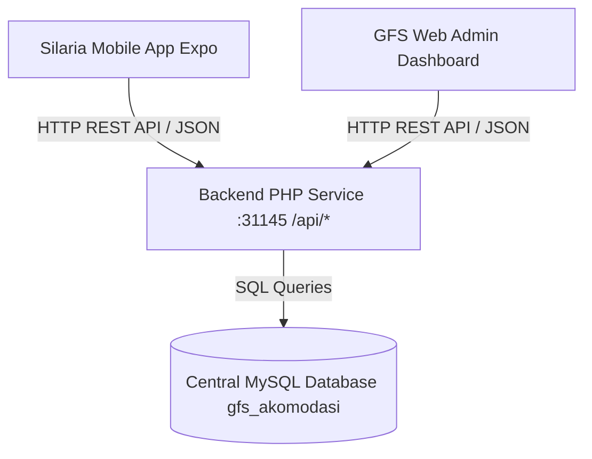
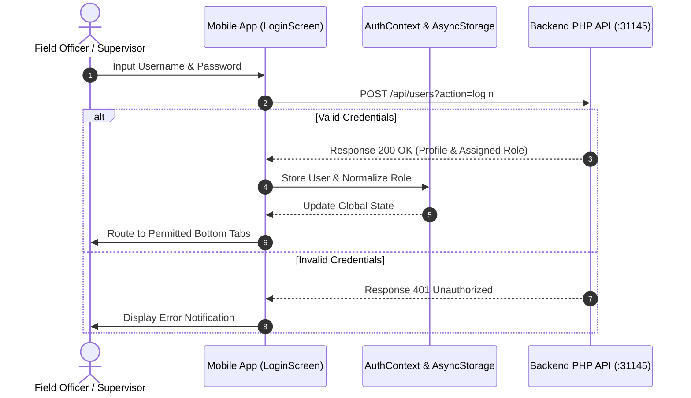

# System Flow & Application Specification - GFS Akomodasi Mobile (Silaria Mobile)

This document provides a comprehensive technical specification of the **System Flow**, **Role-Based Access Control (RBAC)**, **Transaction Lifecycle State Machines**, and **API Contracts & Integrations** fully synchronized between the Web Administration Dashboard (`gfs_akomodasi`) and the Mobile Operational Companion App (`silaria_mobile`).

---

## 1. General Architecture & System Integration

The Mobile Application is engineered as a **Field Operational Companion App** built with React Native & Expo. It enables on-site officers (Frontdesk, Transport Drivers, Canteen Officers, and Laundry Personnel) to perform real-time data entry and status updates directly from mobile devices.



- **Single Central Database:** Both the Mobile App and the Web Admin Dashboard connect to the same MySQL database (`gfs_akomodasi`).
- **Instant Synchronization:** Actions taken by field staff on mobile (e.g., guest check-in, meal approvals, box dispatches) are instantly committed to the central database and immediately visible on the Web Admin Dashboard.
- **Local Master Data Caching:** Dynamic reference datasets (vacant rooms, drop points, meal delivery points) are cached locally on the device (`masterCache`), ensuring seamless operation even under fluctuating field network conditions.

---

## 2. Authentication & Role-Based Access Control (RBAC)

User login utilizes REST API authentication with secure persistent local device storage (`AsyncStorage`) managed globally via `AuthContext`.



### RBAC Matrix (Role-Based Access Control)

| System Role | Field Operational Description | Information | Reservations & In/Out | Meals Request & Schedule | Laundry Drop & Room Distribute | Transport Driver (Box Logistics) | Central Laundry (Wash & Weigh) |
| :--- | :--- | :---: | :---: | :---: | :---: | :---: | :---: |
| **SUPER / ADMIN** | System Owner & General Manager | ✅ | ✅ | ✅ | ✅ | ✅ | ✅ |
| **SUPERVISOR** | Field Supervisor & Approver | ✅ | ✅ | ✅ *(Can Approve)* | ✅ *(Monitoring)* | ✅ *(Monitoring)* | ✅ *(Monitoring)* |
| **FRONTDESK** | Front Office & Mess Receptionist | ✅ | ✅ | ✅ *(Request)* | ❌ | ❌ | ❌ |
| **CANTEEN** | Kitchen Staff & Catering Officer | ✅ | ❌ | ✅ *(View Schedule & Order)* | ❌ | ❌ | ❌ |
| **LAUNDR** | Mess Attendant / Laundry Dropper | ✅ | ❌ | ❌ | ✅ | ❌ | ❌ |
| **DRIVER** | Logistics Transport Driver | ✅ | ❌ | ✅ *(Delivery Schedule)* | ❌ | ✅ | ❌ |
| **LAUNDRY** | Central Laundry Facility Operator | ✅ | ❌ | ❌ | ❌ | ❌ | ✅ |

*Note: The mobile system automatically normalizes database roles (e.g., `fron` is mapped to `FRONTDESK`, and `supervisor` is mapped to `SUPERVISOR`).*

---

## 3. End-to-End System Workflow Diagram

```mermaid
flowchart TD
    subgraph A[1. RESERVATIONS & GUEST MANAGEMENT]
        A1[Create New Guest Reservation] --> A2[Status: SCHEDULED]
        A2 -->|Guest Arrives on Site| A3[Action: Quick Check-In]
        A3 --> A4[Status: ON SITE / Room Occupied]
        A4 -->|Guest Departs / Assignment Ends| A5[Action: Quick Check-Out]
        A5 --> A6[Status: OFF SITE / Room Vacant]
    end

    subgraph B[2. MEALS SERVICES MODULE]
        B1[Resident Status: ON SITE] -.->|Automatic Roster| B2[Daily Meals Schedule Routine]
        B3[Submit Meals on Request Form] --> B4[Status: PENDING]
        B4 -->|Approval by Supervisor / Admin| B5[Status: APPROVED]
        B5 --> B6[Kitchen Prepares & Driver Dispatches]
    end

    subgraph C[3. END-TO-END LAUNDRY LIFECYCLE]
        C1[Collect Soiled Bag from Room] --> C2[Submit Laundry Drop Form]
        C2 --> C3[Status: DROPPED_AT_POINT]
        C3 -->|Driver Dispatches Container Box| C4[Status: DELIVERED_TO_LAUNDRY]
        
        C4 --> C5{Inspection & Weighing at Central}
        C5 -->|Accepted| C6[Status: RECEIVED_AT_LAUNDRY]
        C5 -->|Rejected| C10[Bypass Directly to Return Queue]
        
        C6 --> C7[Input Clothes Items Details / Details Added]
        C7 --> C8[Washing, Drying, Ironing & Packing]
        C8 --> C9[Status: PROCESS_COMPLETED]
        
        C9 --> C11[Driver Returns Container Box to Drop Point]
        C10 --> C11
        C11 --> C12[Status: RETURNED_TO_DROP]
        
        C12 -->|Mess Attendant Delivers to Room| C13[Status: DISTRIBUTED_TO_ROOM]
    end
```



---

## 4. Module Specifications & Operational Details

---

### 🟢 MODULE 1: RESERVATIONS & GUEST IN/OUT

This module features two distinct sub-views (*Sub-Tabs*):
1. **New Reservation (Room Booking Form):**
   - Captures guest booking details: `category`, `guestName`, `room_id`, `estimated_arrival`, `estimated_departure`, and `remark`.
   - Rooms are dynamically filtered according to guest category (`GET /api/rooms?category=...`).
   - Initial reservation status is recorded as **`SCHEDULED`**, allocating the room.
2. **Check-In / Out & Guest Management:**
   - Displays all active reservations fetched via `GET /api/reservations`.
   - Includes real-time search (by name, room, or mess) and status filters (*ALL, SCHEDULED, ON SITE, OFF SITE*).
   - **Quick Check-In (`ON SITE`):** When a guest arrives, the Frontdesk officer taps Check-In. The system stamps `check_in = NOW()` and marks the room actively occupied.
   - **Quick Check-Out (`OFF SITE`):** When a guest departs, the officer taps Check-Out. The system stamps `check_out = NOW()` and sets status to `OFF SITE`, instantly releasing the room back into the vacant pool.

#### API Contracts:
- **Create Booking:** `POST /api/reservations`
  ```json
  {
    "guestName": "John Doe",
    "category": "SPECIAL GUEST",
    "room_id": 12,
    "estimated_arrival": "2026-10-20 14:00:00",
    "estimated_departure": "2026-10-25 12:00:00",
    "remark": "VIP Delegate from Head Office"
  }
  ```
- **Update Check-In / Out Status:** `POST /api/reservations`
  ```json
  {
    "action": "update_status",
    "id": 15,
    "status": "ON SITE"
  }
  ```

---

### 🟡 MODULE 2: MEALS SERVICES

This module cleanly distinguishes between special/extra catering orders (*Meals on Request*) and routine daily allowances (*Daily Schedule*):

1. **Meals on Request:**
   - **Order Submission Form:** Captures guest/event name, package type (`Standard Buffet`, `VIP Buffet`, `Room Delivery`), delivery point (`delivery_point_id` from `/api/meals?type=dp`), meal time (`BREAKFAST`, `LUNCH`, `DINNER`), number of packs, and dietary notes.
   - **Initial Status:** Recorded as **`PENDING`**.
   - **Approval Workflow:** Users holding `SUPER`, `ADMIN`, or `SUPERVISOR` roles can tap **"✓ Approve Request"** directly on the mobile app. The status changes to **`APPROVED`** (stamping `approved_by`), authorizing kitchen preparation.
2. **Daily Meals Schedule:**
   - Displays the consolidated daily catering schedule for all residents currently **`ON SITE`** (`GET /api/meals?type=schedule`).
   - Enables kitchen staff to plan meal portion counts and drivers to verify breakfast, lunch, and dinner drop points.

#### API Contracts:
- **Create Meal Request:** `POST /api/meals`
  ```json
  {
    "action": "create_request",
    "guest_name": "Operations Strategy Meeting",
    "request_by": "Frontdesk Staff",
    "meals_package": "VIP Buffet",
    "delivery_point_id": 2,
    "meal_time": "LUNCH",
    "no_of_packs": 10,
    "remark": "Serve at 12:00 PM in Conference Room 1"
  }
  ```
- **Approve Meal Request:** `POST /api/meals`
  ```json
  {
    "action": "approve_request",
    "id": 8,
    "approved_by": "Field Supervisor"
  }
  ```

---

### 🔵 MODULE 3: LAUNDRY SERVICES LIFECYCLE

The Laundry Module is structured into two main tabs reflecting field operational responsibilities:

#### TAB 1: DROPPING & DISTRIBUTING

1. **Sub-Tab 1: Drop Form (Mess Attendants - Role `LAUNDR`):**
   - Collects soiled laundry bags from guest rooms.
   - Captures: Guest Name, Room Number, Laundry Bag ID, Laundry Box ID, Services Package, Drop Point.
   - Transaction status recorded: **`DROPPED_AT_POINT`**.
2. **Sub-Tab 2: Driver Logistics (Transport Drivers - Role `DRIVER`):**
   - Manages large transport containers (**Laundry Boxes**) listed in `boxList`.
   - **Deliver to Central:** Driver taps **"↗ Deliver to Central Laundry"** (`action: "deliver_to_laundry"`). All bags within that box transition to **`DELIVERED_TO_LAUNDRY`**.
   - **Return to Drop Point:** Driver taps **"↩ Return Box to Drop Point"** (`action: "return_to_drop"`). All finished and rejected bags within that box transition to **`RETURNED_TO_DROP`**.
3. **Sub-Tab 3: Room Distribution (Mess Attendants - Role `LAUNDR`):**
   - Displays clean laundry bags returned from central (`PROCESS_COMPLETED` or `RETURNED_TO_DROP`) as well as rejected bags (`Rejected`).
   - Attendant taps **"✓ Deliver to Room"** (`action: "distribute_to_room"`). The final status becomes **`DISTRIBUTED_TO_ROOM`** (Completed).

#### TAB 2: RECEIVING & CLEANING (Central Laundry - Role `LAUNDRY`)

1. **Step 1: Receive & Weigh (Inspection):**
   - Central laundry operators inspect incoming bags (with quick one-tap selector for arriving bags).
   - Enter measured weight (kg) and select Bag Status:
     - **If `Accepted`:** Status transitions to **`RECEIVED_AT_LAUNDRY`**, and the app automatically advances to Step 2 (Clothes Item Details).
     - **If `Rejected` (*Rejected Bag Flow*):** The system marks the bag as **`Rejected`**, displays an informative banner, and **bypasses washing and itemization stages**. The bag is directly routed to the return queue.
2. **Step 2: Clothes Item Details (Inventory):**
   - Applicable only to `Accepted` bags.
   - Records itemized rows (clothes type, brand, colour, size, quantity).
   - Automatically computes total piece counts.
   - Status recorded: **`DETAILS_ADDED`**.
3. **Step 3: Mark Process Completed:**
   - After washing, drying, pressing, and packaging into container boxes.
   - Operator taps **"✓ Mark Process Completed"** (`action: "complete_process"`).
   - Status transitions to **`PROCESS_COMPLETED`**.

---

## 5. Summary of Laundry Transaction States (`current_status`)

```text
[ DROPPED_AT_POINT ]      : Soiled bag placed at Mess Drop Point
         │
         ▼ (Driver Dispatches Box)
[ DELIVERED_TO_LAUNDRY ]  : Container arrived at Central Laundry
         │
         ├──────────────────────────────┐
         ▼ (If Accepted)                ▼ (If Rejected)
[ RECEIVED_AT_LAUNDRY ]          [ RECEIVED_AT_LAUNDRY (Rejected) ]
         │                              │ (Bypasses Washing & Details)
         ▼                              │
[ DETAILS_ADDED ]                       │
         │                              │
         ▼ (Washing & Packing Finished) │
[ PROCESS_COMPLETED ]                   │
         │                              │
         └──────────────┬───────────────┘
                        ▼ (Driver Returns Box)
             [ RETURNED_TO_DROP ]   : Box arrived back at Mess Drop Point
                        │
                        ▼ (Attendant Delivers to Room)
             [ DISTRIBUTED_TO_ROOM ]: Completed (Handed over to Guest)
```

---

## 6. Backend Integration & Synchronization Notes

1. **Query Enhancements in `LaundryModel.php`:**
   - The `receiveBag()` method has been updated to accept bags with either `DROPPED_AT_POINT` or `DELIVERED_TO_LAUNDRY` status:
     ```sql
     WHERE laundry_bag_id = ? AND current_status IN ('DROPPED_AT_POINT', 'DELIVERED_TO_LAUNDRY')
     ```
   - The `distributeToRoom()` method has been updated to accept bags that passed through the driver return stage or were marked rejected:
     ```sql
     WHERE laundry_bag_id = ? AND (current_status IN ('PROCESS_COMPLETED', 'RETURNED_TO_DROP') OR (bag_status = 'Rejected'))
     ```

2. **Payload Flexibility in `LaundryController.php`:**
   - Added automatic normalization for action aliases (`drop`, `deliver`, `receive`, `complete`, `return`, `distribute`).
   - Added automatic data unpacking for nested parameters (`$input['data']`) and fallback ID mappings (`laundry_bag_id` vs `id`).
